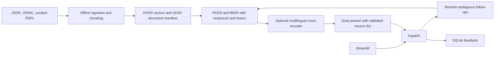

# Chatbot-SEU 2.0

Chatbot-SEU is a retrieval-augmented assistant for Southeast University, Bangladesh. It uses the bundled website archive and can ingest curated notices, calendars, and text-based PDFs. Streamlit offers English and Bangla interfaces, conversation reset, source links, and feedback. FastAPI serves the chat and source catalog, and SQLite stores feedback.

## Architecture



Greetings bypass inference in the chat service. Other requests search the same chunks through sentence-transformer embeddings and BM25, then fuse the rankings with an extra signal for explicitly named page titles. An optional cross-encoder reranks a bounded candidate set. The answer prompt treats retrieved text as untrusted data and asks Groq to classify scope, abstain when evidence is insufficient, and cite only supplied evidence. The service validates the citation IDs and constructs links from the source metadata. This checks references, while claim-level grounding still needs evaluation.

## Local setup

Use Python 3.12 and run from the repository root.

```sh
python -m venv .venv
# Activate .venv for your shell.
python -m pip install -r requirements.txt
# Copy .env.example to .env and set GROQ_API_KEY.
python -m src.store
python -m uvicorn src.api:app --host 127.0.0.1 --port 8000
```

In a second shell with the same environment, run `python -m streamlit run app.py`. The app opens at http://localhost:8501. On Windows hosts whose Application Control policy blocks the FAISS extension, run the backend and index builder in Ubuntu under WSL or in the Linux container. Tests run with `python -m unittest discover -s tests -v`.

| Environment variable | Purpose |
| --- | --- |
| `GROQ_API_KEY`, `GROQ_MODEL` | Backend authentication and completion model. Defaults to `openai/gpt-oss-20b` after the original Llama model was retired for free and developer-tier accounts. |
| `SEU_API_URL` | Backend URL used by Streamlit |
| `SEU_INDEX_DIR` | Index directory used by FastAPI |
| `SEU_EMBEDDING_MODEL` | Build and query model. Defaults to MiniLM. Try `BAAI/bge-m3` for multilingual dense retrieval and rebuild the index. |
| `RETRIEVAL_CANDIDATES`, `RETRIEVAL_LIMIT`, `RRF_K`, `MIN_DENSE_SCORE` | Candidate depth, final evidence count, rank-fusion constant, and minimum cosine score |
| `RERANK_MODEL` | Optional cross-encoder, for example `BAAI/bge-reranker-v2-m3` |
| `CORS_ORIGINS` | Comma-separated permitted browser origins. Empty by default. |
| `FEEDBACK_DB` | SQLite feedback file path |

## Knowledge-base updates

Run `python -m src.store --data data/your_sources.jsonl --index-dir vectorstore/faiss_index` offline. A record accepts `clean_text` or a relative `pdf_path`. It can include `id`, `title`, `source_url`, `category`, and `updated_at` as an ISO date. Use categories such as `notice` and `academic_calendar`. Document dates come from supplied metadata. Missing, invalid, future, and more than one-year-old dates are flagged as potentially outdated. Scanned PDFs require OCR before ingestion.

The builder skips unchanged corpora and deduplicates exact chunk records. Changed corpora rebuild the index as an atomic replacement. Rebuild when changing the embedding model. Existing pickle-backed indexes require a rebuild. Serve the new artifact from a trusted volume and restart FastAPI after swapping the index. Administrative ingestion runs through the CLI.

## API

| Endpoint | Input and output |
| --- | --- |
| `POST /chat` | Accepts `question`, optional `history` containing up to five question/answer pairs, and `language` set to `auto`, `en`, or `bn`. Returns answer, route, citations, evidence count, timing, and request ID. |
| `GET /health` | Returns process status and index-artifact presence. |
| `GET /sources` | Returns titles, source URLs, categories, and freshness flags. |
| `POST /feedback` | Accepts `request_id` and a boolean `helpful`. A subsequent vote for the same ID replaces the previous one. |

Interactive OpenAPI docs are available at `/docs` on the backend.

## Evaluation

Run `python -m evaluation.run` to compare the original dense retrieval configuration, hybrid retrieval, hybrid with reranking, and reranking plus rewriting. It reports source Recall@K, truncated MRR, and mean elapsed search time. The benchmark includes English, Bangla, Banglish, follow-up, out-of-scope, unanswerable, and greeting cases. Retrieval metrics use the five cases with labeled relevant sources.

Run `python -m evaluation.answers export review.json` to capture generated answers and evidence. Mark each answer relevant if it addresses the actual query or appropriately abstains or routes it. Count independently checkable factual claims and count those supported by the retrieved excerpts. Run `python -m evaluation.answers score review.json` to aggregate binary relevance, supported-claim fraction, unsupported-claim fraction as the operational hallucination rate, and latency. Pass `--pause 8` to pace provider requests. Rerun the same export to resume after a rate limit.

| Measured run | Queries | Recall@5 | MRR@5 | Mean search time |
| --- | ---: | ---: | ---: | ---: |
| BM25 on archived documents | 5 | 0.20 | 0.10 | 0.60 ms |
| Original dense MiniLM | 5 | 0.20 | 0.067 | 11.71 ms |
| Hybrid MiniLM and BM25 with title matching | 5 | 0.60 | 0.40 | 29.27 ms |
| Hybrid multilingual MiniLM and BM25 | 5 | 0.60 | 0.50 | 41.80 ms |
| Multilingual hybrid with reranking | 5 | 0.40 | 0.25 | 974.12 ms |
| Multilingual hybrid with reranking and rewriting | 5 | 0.40 | 0.25 | 812.67 ms |

### Live answer review

Each run used the same eight benchmark questions and GPT-OSS 20B. The original baseline uses its original retrieval and prompt configuration with the available Groq model. One reviewer marked relevance and counted factual claims supported by the retrieved excerpts.

| Answer variant | Relevant answers | Supported claims | Unsupported claims | Mean latency |
| --- | ---: | ---: | ---: | ---: |
| Original dense MiniLM | 2/8 | 0/1 | 100% | 416 ms |
| Archive-document BM25 | 3/8 | 12/17 | 29.4% | 788 ms |
| Hybrid MiniLM | 5/8 | 7/9 | 22.2% | 732 ms |
| Multilingual hybrid with reranking | 3/8 | 0/1 | 100% | 1,477 ms |
| Multilingual hybrid with reranking and rewriting | 5/8 | 2/3 | 33.3% | 1,242 ms |

The denominators show how often a variant made a factual claim. A variant that abstains frequently can have a fragile unsupported-claim rate. The runs exposed missing admissions qualifiers and citations to statements about the wrong organizational unit. The prompt now emphasizes evidence qualifiers and scope, and the service rechecks unrelated queries when evidence is inconclusive. The answer runs preceded that final prompt and routing adjustment.

The BM25-only run ranks full documents on Windows. The FAISS variants rank chunks and ran in CPU-only Ubuntu under WSL because Windows Application Control blocked native FAISS imports. With five labeled queries, these results show observed behavior on the supplied archive and give limited evidence of performance on production traffic. The multilingual comparison used `sentence-transformers/paraphrase-multilingual-MiniLM-L12-v2` with `cross-encoder/mmarco-mMiniLMv2-L12-H384-v1`. The reranking stage reduced retrieval quality in this sample, so it remains optional. The first reranking run includes loading the model into memory. The rewrite variant reused that model, so its lower mean latency does not imply that rewriting made reranking faster.

## Docker deployment

```sh
# Copy .env.example to .env and set the backend configuration first.
docker compose build
docker compose run --rm api python -m src.store
docker compose up
```

The API port binds to loopback and Streamlit communicates with it over the Compose network. The vector store and feedback database use a bind mount. The Hugging Face model cache uses a named volume. For a public deployment, use TLS, rate limits, and access controls at the ingress before exposing the chat and feedback endpoints.

## Limitations

The existing LangChain community FAISS integration is deprecated in the installed release. Migrating the integration is a maintenance follow-up. The archive has limited date metadata and cannot establish current policies, fees, or deadlines. Banglish transliteration can differ from archive wording. MiniLM remains the lower-resource default. The tested multilingual model improved mean reciprocal rank on this sample. BGE-M3 is supported through model configuration and was not included in the measured run. Citation-ID validation and an evidence-only prompt reduce risk, while independent claim verification and adversarial evaluation remain future work.
