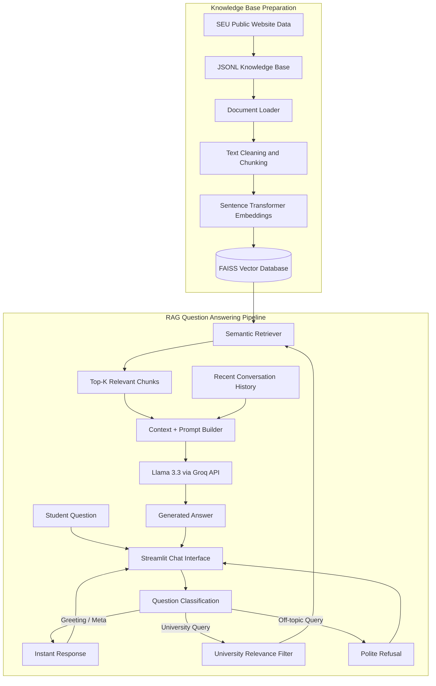
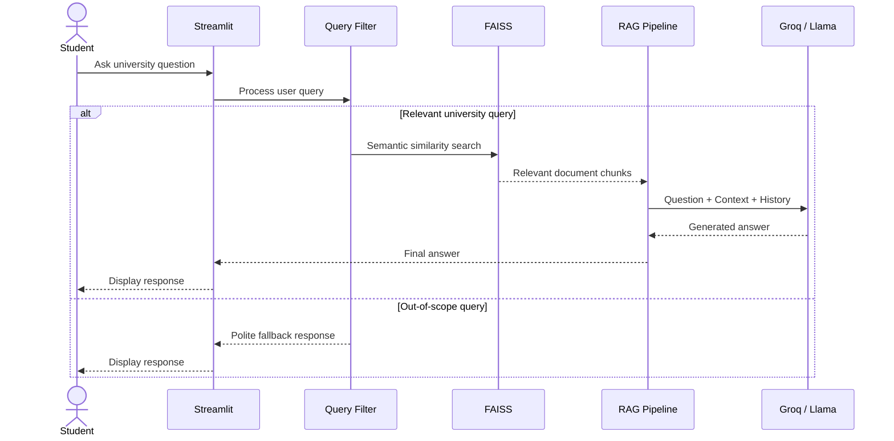
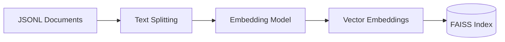

# 🎓 Chatbot-SEU
### AI-Powered University Assistant Using Retrieval-Augmented Generation (RAG)

[](https://www.python.org/)
[](https://streamlit.io/)
[](https://www.langchain.com/)
[](https://github.com/facebookresearch/faiss)
[](https://groq.com/)

**Chatbot-SEU** is an AI-powered university information assistant developed to help students and prospective applicants of **Southeast University (SEU), Bangladesh** access academic and administrative information through natural language conversations.

The system uses **Retrieval-Augmented Generation (RAG)**, combining semantic search with a Large Language Model (LLM) to retrieve relevant university information and generate context-aware responses.

The project aims to make university information more accessible while reducing the need to manually search multiple web pages.

**GitHub Repository:** [Chatbot-SEU](https://github.com/arrahmanriju/Chatbot-SEU)

---

## 📌 Problem Statement

University students frequently need information about admission, tuition fees, academic programs, course registration, scholarships, and university policies.

However, this information is often distributed across different university website pages and documents, making it time-consuming to find.

Traditional FAQ systems are limited to predefined questions and may struggle with natural language variations.

**Chatbot-SEU addresses this problem by providing a conversational interface powered by RAG.**

Instead of relying entirely on an LLM's pretrained knowledge, the chatbot retrieves information from a university-specific knowledge base before generating an answer.

---

## 🎯 Project Objectives

- Develop an intelligent university question-answering system.
- Provide quick access to Southeast University information.
- Implement Retrieval-Augmented Generation using LangChain.
- Retrieve relevant information using semantic similarity search.
- Reduce unsupported responses through context-grounded generation.
- Support conversational follow-up questions.
- Create an expandable knowledge base for university information.
- Provide a user-friendly chatbot interface.

---

## ✨ Key Features

| Feature | Description |
|---|---|
| University Q&A | Answers questions related to Southeast University |
| RAG Pipeline | Combines information retrieval with LLM generation |
| Semantic Search | Retrieves relevant information using vector embeddings |
| FAISS Vector Database | Stores and searches document embeddings |
| Llama LLM | Generates natural language answers using Groq |
| Conversation Context | Uses recent chat history for follow-up questions |
| Query Filtering | Attempts to identify university-related questions |
| Streamlit Interface | Provides an interactive web-based chatbot |
| JSONL Knowledge Base | Stores structured university website information |
| Modular Architecture | Separates retrieval, embeddings, filtering, and generation |
| Docker Support | Supports containerized execution and deployment |

---

## 🏗️ System Architecture

The project follows a Retrieval-Augmented Generation architecture with two major pipelines:

1. **Knowledge Base Preparation:** Processes university information and builds the vector database.
2. **Question Answering:** Retrieves relevant information and generates an LLM response.



### Architecture Explanation

**1. Data Collection**

University-related information is collected from publicly available Southeast University website content and stored in JSONL format.

**2. Document Processing**

The text is loaded, cleaned, and divided into smaller overlapping chunks to improve retrieval.

**3. Embedding Generation**

The Sentence Transformer model converts text chunks into numerical vector representations.

**4. Vector Storage**

Generated embeddings are stored in FAISS for efficient similarity searching.

**5. Query Processing**

When a student submits a question, the system checks the message type and whether it is relevant to the university.

**6. Context Retrieval**

The retriever identifies the most relevant document chunks based on semantic similarity.

**7. Response Generation**

Retrieved information and recent conversation history are passed to the Llama model through Groq.

**8. Final Response**

The generated answer is displayed in the Streamlit interface.

---

## 🔄 RAG Workflow



---

## 🛠️ Technology Stack

| Component | Technology |
|---|---|
| Programming Language | Python |
| Frontend | Streamlit |
| RAG Framework | LangChain |
| LLM | Llama 3.3 70B via Groq |
| Embedding Model | sentence-transformers/all-MiniLM-L6-v2 |
| Vector Database | FAISS |
| Knowledge Base | JSONL |
| Configuration | Python Dotenv |
| Containerization | Docker |
| Version Control | Git and GitHub |

### Why These Technologies?

**LangChain:** Helps organize the retrieval and LLM response generation pipeline.

**FAISS:** Provides efficient vector similarity search without requiring a separate database server.

**Sentence Transformers:** Converts university documents and user queries into semantic embeddings.

**Groq:** Provides hosted LLM inference, removing the need to run a large language model locally.

**Streamlit:** Enables rapid development of an interactive Python-based chatbot interface.

---

## 📁 Project Structure

The original RAG application is organized into the following modules:

```text
Chatbot-SEU/
│
├── app.py
│
├── src/
│   ├── loader.py
│   ├── splitter.py
│   ├── embedder.py
│   ├── store.py
│   ├── filter.py
│   ├── retriever.py
│   ├── prompt_builder.py
│   ├── llm.py
│   └── chain.py
│
├── data/
│   └── old_seu_website_cleaned.jsonl
│
├── vectorstore/
│   └── faiss_index/          # Generated locally
│
├── .streamlit/
│   └── config.toml
│
├── Dockerfile
├── requirements.txt
├── .gitignore
└── README.md
```

### Module Responsibilities

| Module | Responsibility |
|---|---|
| `loader.py` | Loads university data from JSONL |
| `splitter.py` | Divides documents into text chunks |
| `embedder.py` | Initializes the embedding model |
| `store.py` | Builds and saves the FAISS vector index |
| `filter.py` | Handles message classification and relevance filtering |
| `retriever.py` | Retrieves relevant document chunks |
| `prompt_builder.py` | Constructs context-grounded LLM prompts |
| `llm.py` | Communicates with the Groq API |
| `chain.py` | Connects the full chatbot pipeline |
| `app.py` | Runs the Streamlit user interface |

> Note: The project structure may change as additional features are implemented.

---

## 🗄️ Knowledge Base and Vector Database

The chatbot uses a university-specific knowledge base created from publicly available information.

The original dataset contains **333 records** extracted from Southeast University's website.

### Knowledge Base Format

Data is stored in JSONL format, where each line contains a separate JSON object.

Example:

```json
{
  "id": 1,
  "title": "Southeast University Information",
  "source_url": "https://seu.edu.bd/",
  "clean_text": "Information about Southeast University..."
}
```

### Document Processing Pipeline



The existing system uses:

- Embedding model: `all-MiniLM-L6-v2`
- Embedding dimensions: 384
- Chunk size: 500 characters
- Chunk overlap: 100 characters
- Retrieval: Top 5 relevant chunks

The FAISS index is generated from the source documents rather than manually populated.

### Updating the Knowledge Base

University information can be expanded by adding verified public records to the existing JSONL dataset.

After updating the dataset, rebuild the vector index:

```bash
python -m src.store
```

This allows the chatbot to use new university information without fine-tuning the LLM.

---

## 💬 Example Student Questions

The chatbot is intended to help with questions such as:

### Admission and Tuition

- What are the admission requirements for CSE?
- What is the tuition fee for BBA?
- How many credits are required for CSE?
- What scholarships are available at SEU?

### Academic Information

- What programs are offered by Southeast University?
- What is the university grading system?
- How can students find academic information?
- What are the requirements for different degree programs?

### University Information

- Where is Southeast University located?
- What is the mission of Southeast University?
- Which departments are available?
- How can I find faculty information?

### Student Support

- How can I find university notices?
- Where can I find admission information?
- What academic resources are available for students?

**Note:** Responses depend on the information available in the knowledge base. Example questions are not guarantees that every answer is currently supported.

---

## ⚙️ Installation and Setup

### Prerequisites

Make sure the following tools are installed:

- Python 3.11
- Git
- pip
- Groq API key

You can obtain a Groq API key from:

https://console.groq.com/keys

### Step 1: Clone the Repository

```bash
git clone https://github.com/arrahmanriju/Chatbot-SEU.git
cd Chatbot-SEU
```

### Step 2: Create a Virtual Environment

**Windows:**

```powershell
py -3.11 -m venv venv
```

Activate it:

```powershell
.\venv\Scripts\Activate.ps1
```

**Linux / macOS:**

```bash
python3 -m venv venv
source venv/bin/activate
```

### Step 3: Install Dependencies

```bash
python -m pip install --upgrade pip
pip install -r requirements.txt
```

### Step 4: Configure Environment Variables

Create a `.env` file in the project root:

```env
GROQ_API_KEY=your_groq_api_key_here
```

Replace the placeholder with your actual Groq API key.

**Security:** Never upload API keys or your `.env` file to GitHub.

### Step 5: Build the FAISS Vector Database

```bash
python -m src.store
```

The command loads the knowledge base, generates embeddings, and stores the FAISS index locally.

### Step 6: Run the Chatbot

```bash
python -m streamlit run app.py
```

Open your browser and visit:

```text
http://localhost:8501
```

The chatbot should now be accessible locally.

---

## 🐳 Docker Setup

The project includes a Dockerfile for containerized deployment.

### Build the Docker Image

```bash
docker build -t chatbot-seu .
```

### Run the Container

```bash
docker run --env-file .env -p 8501:8501 chatbot-seu
```

Visit:

```text
http://localhost:8501
```

**Important:** The FAISS index must be available inside the container, either by including it during the build, mounting it, or generating it at startup. Check the Dockerfile and `.dockerignore` before deployment.

---

## 🚀 Deployment

The Streamlit application can be deployed using a hosting service that supports Python applications.

### Option 1: Streamlit Community Cloud

1. Push the repository to GitHub.
2. Visit https://share.streamlit.io/.
3. Connect your GitHub account.
4. Select the `Chatbot-SEU` repository.
5. Select the `main` branch.
6. Set the entry point to `app.py`.
7. Configure Python dependencies and secrets.
8. Add `GROQ_API_KEY` in the app's secrets.
9. Ensure the FAISS index can be built or loaded.
10. Deploy and test the application.

### Option 2: Docker-Based Hosting

The Dockerfile can be adapted for services such as Render or Railway.

Deployment requires:

- Installing Python dependencies
- Making the FAISS index available
- Configuring the Groq API key
- Exposing the Streamlit application port
- Providing sufficient memory for the embedding model

---

## 🧪 Testing and Evaluation

The original project supports manual testing through the chatbot interface and Python modules.

Example:

```bash
python -m src.chain
```

### Suggested Evaluation Metrics

| Metric | Purpose |
|---|---|
| Retrieval Recall@K | Measures relevant document retrieval |
| Mean Reciprocal Rank | Evaluates ranking quality |
| Answer Correctness | Measures factual accuracy |
| Faithfulness | Measures consistency with retrieved context |
| Response Latency | Measures response time |
| Out-of-Scope Detection | Evaluates query filtering |
| Answerability | Evaluates handling of missing information |

Automated benchmark results have not yet been published.

---

## ⚠️ Known Limitations

1. Some information in the original university dataset may be outdated.
2. The English-focused embedding model may perform poorly on Bangla or Banglish queries.
3. Semantic similarity filtering may incorrectly reject valid university questions.
4. Retrieval quality depends on the coverage and accuracy of indexed information.
5. Similar financial terms, such as admission fees and tuition fees, may require more precise intent handling.
6. The chatbot does not have authorized access to private student records.
7. LLM-generated responses may require additional validation.
8. The original implementation does not include a comprehensive automated evaluation suite.

---

## 🔮 Future Improvements

The project can be extended with the following features:

- [ ] Expand the knowledge base using updated official university information.
- [ ] Add source citations for generated answers.
- [ ] Improve Bangla, English, and Banglish support.
- [ ] Implement hybrid retrieval using BM25 and FAISS.
- [ ] Add document reranking.
- [ ] Improve academic program and fee-intent detection.
- [ ] Introduce conversation-aware query rewriting.
- [ ] Add PDF and university notice ingestion.
- [ ] Implement automated knowledge-base updates.
- [ ] Create a benchmark dataset for RAG evaluation.
- [ ] Introduce user feedback collection.
- [ ] Add FastAPI for external application integration.
- [ ] Optimize performance and deployment.
- [ ] Publish a live chatbot demonstration.

---

## 💡 Why RAG Instead of Fine-Tuning?

Retrieval-Augmented Generation was chosen because university information changes frequently.

Traditional fine-tuning would require additional training whenever important information changes.

With RAG:

1. New university information can be added to the knowledge base.
2. Documents are converted into embeddings.
3. The FAISS vector index is updated.
4. The chatbot retrieves the newly indexed information.
5. The LLM generates responses using the retrieved context.

This approach makes the system easier to maintain and expand without retraining the language model.

---

## 🤝 Contributing

Contributions, suggestions, and improvements are welcome.

To contribute:

1. Fork this repository.
2. Create a feature branch.
3. Make your changes.
4. Test your changes.
5. Submit a pull request.

For bugs or feature requests, open an issue:

[GitHub Issues](https://github.com/arrahmanriju/Chatbot-SEU/issues)

---

## 👨‍💻 Developer

**Azizur Rahman**

Computer Science and Engineering  
Southeast University, Dhaka, Bangladesh

Interested in Artificial Intelligence, Machine Learning, Natural Language Processing, Generative AI, and Retrieval-Augmented Generation.

**Connect with me:**

- **GitHub:** https://github.com/arrahmanriju
- **Codeforces:** https://codeforces.com/profile/riju_rahman

---

## 📜 Disclaimer

This project is developed for educational and research purposes.

Chatbot-SEU is an independent student project and is not an official Southeast University support service.

The chatbot uses publicly available university information. Users should verify important information, including admission fees, tuition rates, academic deadlines, and university policies, through official Southeast University sources.

**Official University Website:** https://seu.edu.bd/

---

### ⭐ Support the Project

If you find this project useful, consider giving the repository a star!

**Built with Python, LangChain, FAISS, Streamlit, and Llama via Groq.**
