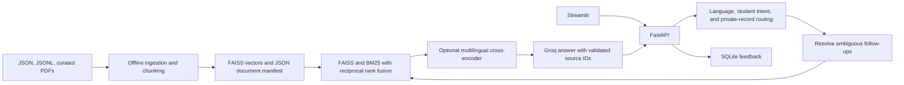

# Chatbot-SEU 2.0 · Student Support Assistant

Chatbot-SEU is a retrieval-augmented assistant for Southeast University, Bangladesh. It uses the bundled website archive and can ingest curated notices, calendars, and text-based PDFs. Streamlit offers English and Bangla interfaces, conversation reset, source links, and feedback. FastAPI serves the chat and source catalog, and SQLite stores feedback.

## Architecture



Greetings bypass inference in the chat service. Other requests search the same chunks through sentence-transformer embeddings and BM25, then fuse the rankings with an extra signal for explicitly named page titles. An optional cross-encoder reranks a bounded candidate set. The answer prompt treats retrieved text as untrusted data and asks Groq to classify scope, abstain when evidence is insufficient, and cite only supplied evidence. The service validates the citation IDs and constructs links from the source metadata. This checks references, while claim-level grounding still needs evaluation.

## Local setup

Use Python 3.12 and run from the repository root.

```sh
python -m venv .venv
# Activate .venv for your shell.
python -m pip install -r requirements.txt
# Copy .env.example to .env and set GROQ_API_KEY.
python -m src.store
python -m uvicorn src.api:app --host 127.0.0.1 --port 8000
```

In a second shell with the same environment, run `python -m streamlit run app.py`. The app opens at http://localhost:8501. On Windows hosts whose Application Control policy blocks the FAISS extension, run the backend and index builder in Ubuntu under WSL or in the Linux container. Tests run with `python -m unittest discover -s tests -v`.

| Environment variable | Purpose |
| --- | --- |
| `GROQ_API_KEY`, `GROQ_MODEL` | Backend authentication and completion model. Defaults to `openai/gpt-oss-20b` after the original Llama model was retired for free and developer-tier accounts. |
| `SEU_API_URL` | Backend URL used by Streamlit |
| `SEU_INDEX_DIR` | Index directory used by FastAPI |
| `SEU_EMBEDDING_MODEL` | Build and query model. Defaults to MiniLM. Try `BAAI/bge-m3` for multilingual dense retrieval and rebuild the index. |
| `RETRIEVAL_CANDIDATES`, `RETRIEVAL_LIMIT`, `RRF_K`, `MIN_DENSE_SCORE` | Candidate depth, final evidence count, rank-fusion constant, and minimum cosine score |
| `RERANK_MODEL` | Optional cross-encoder, for example `BAAI/bge-reranker-v2-m3` |
| `CORS_ORIGINS` | Comma-separated permitted browser origins. Empty by default. |
| `FEEDBACK_DB` | SQLite feedback file path |

## Student support

The sidebar offers two example questions for each of the 15 student categories. Auto language mode detects English, Bangla, and common Banglish forms. English and Bangla can also be selected explicitly. Public navigation and account-access rules handle straightforward requests before search or model inference. For mixed public questions, retrieval gathers evidence for up to three clauses. The assistant sends no authorized-account requests and does not log in to UMS. The feedback store holds response IDs and votes.

- [Coverage and knowledge gaps](STUDENT_COVERAGE.md) lists verified public sources and missing procedures by category.
- [Student questions](data/student_questions.jsonl) contains 225 generated prompts. There are five scenarios per category, written in three languages, with alternate phrasing, expected behavior, source IDs, and privacy labels.
- [Evaluation dataset](data/evaluation_dataset.jsonl) groups translations and paraphrases together by semantic intent. Its 45 test prompts cover 15 held-out scenarios. The 45 development prompts cover distinct private-record scenarios. No model was fitted to these files.
- [Verified student sources](data/verified_student_sources.jsonl) contains public-source summaries, 17 program fee rows, and a separate admission-charges record. Retrieval timestamps are recorded separately from publication dates. Multilingual search aliases improve keyword matching and are excluded from answer evidence.

Program fee queries retrieve structured rows by program from the loaded FAISS index. The formatter checks the official source, applicable admission session, and consistency of the published figures before displaying them. MBA (Regular) and MBA (One-Year) are separate rows. Program comparisons use a common session. The Fall 2025 prospectus explicitly labels the Pharmacy row Spring 2026. Current-rate requests disclose that current figures could not be verified. Admission charges are shown separately from the published approximate program cost. Fee retrieval uses both program and fee type. The Fall 2025 prospectus gives a general one-time admission charge and a separate undergraduate tuition-deposit rule. Joining queries list the verified components separately and leave the full amount payable unverified. Semester tuition requires the credit load.

## Knowledge-base updates

The default build indexes the legacy archive and the verified student source file together. Run `python -m src.store --data data/your_sources.jsonl --index-dir vectorstore/faiss_index` offline. A record accepts `clean_text` or a relative `pdf_path`. It can include `id`, `title`, `source_url`, `category`, and `updated_at` as an ISO date. Use categories such as `notice` and `academic_calendar`. Document dates come from supplied metadata. Missing, invalid, future, and more than one-year-old dates are flagged as potentially outdated. Scanned PDFs require OCR before ingestion.

The builder skips unchanged corpora and deduplicates exact chunk records. Changed corpora rebuild the index as an atomic replacement. Rebuild when changing the embedding model. Existing pickle-backed indexes require a rebuild. Serve the new artifact from a trusted volume and restart FastAPI after swapping the index. Administrative ingestion runs through the CLI.

## API

| Endpoint | Input and output |
| --- | --- |
| `POST /chat` | Accepts `question`, optional `history` containing up to five question/answer pairs, and `language` set to `auto`, `en`, or `bn`. Returns answer, route, citations, evidence count, timing, and request ID. |
| `GET /health` | Returns process status and index-artifact presence. |
| `GET /sources` | Returns titles, source URLs, categories, and freshness flags. |
| `POST /feedback` | Accepts `request_id` and a boolean `helpful`. A subsequent vote for the same ID replaces the previous one. |

Interactive OpenAPI docs are available at `/docs` on the backend.

### Updating public knowledge

The original 333-record website archive and the curated student sources are retained. The default FAISS build also reads `data/official_updates.jsonl`, an additive overlay generated from approved sources.

```sh
python -m scripts.update_knowledge_base --dry-run
python -m scripts.update_knowledge_base --apply
```

The default input is `scripts/approved_seu_sources.jsonl`. For a new batch, pass `--input path/to/approved.jsonl`. A reviewed record can supply its own stable ID or use the generated ID based on its official URL and scope. Provide `source_url`, `title`, and `clean_text`, plus any known `category`, `program`, `academic_session`, `effective_date`, `retrieved_at`, or `document_type`. Use an ISO date for `effective_date` and a timezone-qualified ISO timestamp for `retrieved_at`.

To extract content from an approved public HTML, PDF, or plain-text URL, set `"fetch": true` on the manifest row and preview it with `--fetch --dry-run`. Review the extracted text and add its printed `expected_sha256` before running `--fetch --apply`. The collector checks robots rules, limits request frequency and size, and stops on access errors or redirects. Review public sources for personal records and omit student-specific documents. An update with failed records leaves the active index and overlay untouched.

Exact duplicates are skipped. Edited overlay records keep a historical copy, and replacements of immutable records use a new ID with an explicit `supersedes` list. The updater stages and validates the merged index, saves a copy of the prior artifact under `vectorstore/kb-backups/`, and publishes to the configured FAISS location. It appends new vectors when the existing chunk prefix and embedding model match. A changed prefix requires a full rebuild. Restart FastAPI after applying changes so its cached retriever reopens the index.

The first overlay adds reviewed information on admission requirements, scholarships, UMS registration and advising, exams and grades, archived notices, career programs, departmental information, library borrowing, and certificate and convocation listings. Public sources verified the existence of several UMS functions. Exact current registration steps, incomplete-advising consequences, internship forwarding-letter instructions, and the graduation-document checklist remain unverified. An archived academic calendar is labeled with its original term. A follow-up batch adds the Central Library directory and service hours, a dated CSE library orientation notice, student ID access rules, and the Fall 2025 BBA concentrations. It preserves the original archive, original curated sources, and prior overlay records.

## Student benchmark

Run `python -m evaluation.student --baseline vectorstore/student-baseline` with the archive-only index preserved before upgrading. For a reconstructed baseline, build the default corpus in the previous checkout and point `--baseline` at its index directory. The comparison uses the same MiniLM embedding model and Recall@5/MRR@5 computed by matching official URLs. Retrieval metrics use the 36 held-out prompts with verified reference sources. Category accuracy uses all 45 held-out prompts and measures the top predicted category.

| Language | Archive Recall@5 | Student Recall@5 | Archive MRR@5 | Student MRR@5 | Category accuracy |
| --- | ---: | ---: | ---: | ---: | ---: |
| All | 5.6% | 97.2% | 0.056 | 0.682 | 84.4% |
| English | 8.3% | 100% | 0.083 | 0.875 | 86.7% |
| Bangla | 0.0% | 91.7% | 0.000 | 0.458 | 80.0% |
| Banglish | 8.3% | 100% | 0.083 | 0.711 | 86.7% |

Mean retrieval latency was 13.96 ms for the archive and 15.00 ms for the student index in this local WSL run. Each group contains translations of the same scenario, so the measurements are scenario-level coverage checks rather than independent estimates of production accuracy. The curated summaries and aliases cover the topics represented in the benchmark. They do not establish coverage of current policies across all categories.

### Live diagnostic

The live diagnostic used six prompts covering admissions contact and lost-certificate replacement in three languages. The archive comparator used the old index and disabled student-specific routing. Its generation configuration approximates the previous service. Manual review checked whether each answer matched the official reference or abstained appropriately. Groundedness measured whether complete factual answers stayed within the scope of the evidence. The unsupported-answer rate is the complement on that factual subset.

| Run | Correct | Grounded factual answers | Unsupported factual answers | Mean service latency |
| --- | ---: | ---: | ---: | ---: |
| Archive comparator | 0/6 | 1/2 | 1/2 | 1,292.20 ms |
| Student routes after targeted fixes | 6/6 | 3/3 | 0/3 | 0.53 ms |

The six prompts informed the targeted admissions-contact and certificate-replacement rules. This is a regression diagnostic, not a blind answer-quality result. The student routes avoided Groq calls, so their latency is not representative of generated answers. The earlier model-only diagnostic also encountered a provider rate limit. Use `python -m evaluation.student --live-output vectorstore/student-live.json` to export a diagnostic run, review its `correct` and `grounded` fields, and use `python -m evaluation.student --score vectorstore/student-live.json` to aggregate it.

## Original RAG evaluation

Run `python -m evaluation.run` to compare the original dense retrieval configuration, hybrid retrieval, hybrid with reranking, and reranking plus rewriting. It reports source Recall@K, truncated MRR, and mean elapsed search time. The benchmark includes English, Bangla, Banglish, follow-up, out-of-scope, unanswerable, and greeting cases. Retrieval metrics use the five cases with labeled relevant sources.

Run `python -m evaluation.answers export review.json` to capture generated answers and evidence. Mark each answer relevant if it addresses the actual query or appropriately abstains or routes it. Count independently checkable factual claims and count those supported by the retrieved excerpts. Run `python -m evaluation.answers score review.json` to aggregate binary relevance, supported-claim fraction, unsupported-claim fraction as the operational hallucination rate, and latency. Pass `--pause 8` to pace provider requests. Rerun the same export to resume after a rate limit.

| Measured run | Queries | Recall@5 | MRR@5 | Mean search time |
| --- | ---: | ---: | ---: | ---: |
| BM25 on archived documents | 5 | 0.20 | 0.10 | 0.60 ms |
| Original dense MiniLM | 5 | 0.20 | 0.067 | 11.71 ms |
| Hybrid MiniLM and BM25 with title matching | 5 | 0.60 | 0.40 | 29.27 ms |
| Hybrid multilingual MiniLM and BM25 | 5 | 0.60 | 0.50 | 41.80 ms |
| Multilingual hybrid with reranking | 5 | 0.40 | 0.25 | 974.12 ms |
| Multilingual hybrid with reranking and rewriting | 5 | 0.40 | 0.25 | 812.67 ms |

### Live answer review

Each run used the same eight benchmark questions and GPT-OSS 20B. The original baseline uses its original retrieval and prompt configuration with the available Groq model. One reviewer marked relevance and counted factual claims supported by the retrieved excerpts.

| Answer variant | Relevant answers | Supported claims | Unsupported claims | Mean latency |
| --- | ---: | ---: | ---: | ---: |
| Original dense MiniLM | 2/8 | 0/1 | 100% | 416 ms |
| Archive-document BM25 | 3/8 | 12/17 | 29.4% | 788 ms |
| Hybrid MiniLM | 5/8 | 7/9 | 22.2% | 732 ms |
| Multilingual hybrid with reranking | 3/8 | 0/1 | 100% | 1,477 ms |
| Multilingual hybrid with reranking and rewriting | 5/8 | 2/3 | 33.3% | 1,242 ms |

The denominators show how often a variant made a factual claim. A variant that abstains frequently can have a fragile unsupported-claim rate. The runs exposed missing admissions qualifiers and citations to statements about the wrong organizational unit. The prompt now emphasizes evidence qualifiers and scope, and the service rechecks unrelated queries when evidence is inconclusive. The answer runs preceded that final prompt and routing adjustment.

The BM25-only run ranks full documents on Windows. The FAISS variants rank chunks and ran in CPU-only Ubuntu under WSL because Windows Application Control blocked native FAISS imports. With five labeled queries, these results show observed behavior on the supplied archive and give limited evidence of performance on production traffic. The multilingual comparison used `sentence-transformers/paraphrase-multilingual-MiniLM-L12-v2` with `cross-encoder/mmarco-mMiniLMv2-L12-H384-v1`. The reranking stage reduced retrieval quality in this sample, so it remains optional. The first reranking run includes loading the model into memory. The rewrite variant reused that model, so its lower mean latency does not imply that rewriting made reranking faster.

## Docker deployment

```sh
# Copy .env.example to .env and set the backend configuration first.
docker compose build
docker compose run --rm api python -m src.store
docker compose up
```

The API port binds to loopback and Streamlit communicates with it over the Compose network. The vector store and feedback database use a bind mount. The Hugging Face model cache uses a named volume. For a public deployment, use TLS, rate limits, and access controls at the ingress before exposing the chat and feedback endpoints.

## Limitations

The existing LangChain community FAISS integration is deprecated in the installed release. Migrating the integration is a maintenance follow-up. The archive has limited date metadata and cannot establish current policies, fees, or deadlines. Banglish transliteration can differ from archive wording. MiniLM remains the lower-resource default. The tested multilingual model improved mean reciprocal rank on this sample. BGE-M3 is supported through model configuration and was not included in the measured run. Citation-ID validation and an evidence-only prompt reduce risk, while independent claim verification and adversarial evaluation remain future work.
